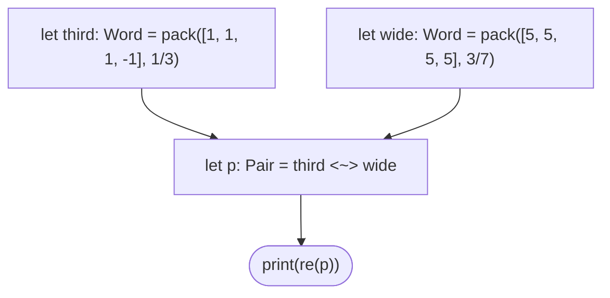

# Felix v1.0

Five promises, every one checked by a test:

1. **A `linear` value is consumed exactly once, or the program does not compile.**
2. **The ternary datapath is the `memnet` reference oracle, bit for bit.** Felix
   does not get its own opinion about packing, folding, or contraction.
3. **Every expression is typed before anything runs.** An unknown name, a
   misspelt builtin, or a word contracted with an integer is a compile error
   with a line and column, never a silent `()`.
4. **Scales are exact `p/q`.** A ratio written in the source survives packing
   and contraction unrounded, all the way to `re(...)` and `im(...)`.
5. **Capsules.** A program and its transcript, sealed so that any other
   implementation can be diffed against this one, byte for byte.

The engineering write-up, covering why each promise is shaped the way it is and what
v1.0 refused to ship, is
[*Felix v1.0: exact p/q, typed builtins, and capsules a second implementation must reproduce*](https://pocoo.vaked.dev/posts/2026-11-03-felix-v1-exact-pq-capsules.html).

## Build from a fresh clone

Felix links its oracle by path (`../memnet`), so clone the two side by side:

```bash
git clone https://github.com/8b-is/memnet.git     # needs 6db3bd5 or later
git clone https://github.com/8b-is/felix.git
cd felix && git checkout v1.0.0
scripts/oneshot.sh                                # ✓ felix 1.0.0 · oneshot green
```

A path dependency instead of a crates.io version is deliberate. If the oracle drifts,
the build breaks. A pinned version would keep building and quietly stop testing anything.

```bash
cargo run -q -- examples/04_exact_pq.flx
```

```
word{gamma:1/3, re:+3/1, im:+0/0}
word{gamma:3/7, re:+4/0, im:+0/0}
(2, 0)
2/7
0
3/2
-2
2
```

And it refuses things, all at once:

```bash
cargo run -q -- examples/05_types_rejected.flx
# error at 4:7: `<~>` contracts two Words; found Word and Int
# error at 5:7: unknown function `pakc`; the builtins are pack, fib, bt, ...
# error at 6:7: `ghost` is not bound
```

## The language, in full

```text
program    := statement* EOF
statement  := "linear"? "let" IDENT "=" expr ";"
            | "consume" "(" expr ")" ";"
            | "print"   "(" expr ")" ";"
expr       := primary ( "<~>" primary )*
primary    := INT | RATIO | "[" [ expr ("," expr)* ] "]"
            | IDENT | IDENT "(" [ expr ("," expr)* ] ")"
RATIO      := INT "/" DIGITS        (no spaces; reduced at scan time; q > 0)
```

The grammar gained one production since v0.1 (`RATIO`). There are still no loops, no functions, and no
mutation. Those land together with a second implementation, or they don't land at all.

**Types:** `Int`, `Ratio`, `Word` (a packed complex ternary word and its exact
scale), `Pair` (a contraction: integer accumulator plus exact scale), `Text`,
`Vault`. A list literal is legal only where a builtin asks for samples.

**Builtins.** The table in [`check.rs`](crates/felix-lang/src/check.rs) is the
whole standard library. A test walks it and evaluates every row, so a builtin
can't exist as a stub.

| Call | Type | Meaning |
|---|---|---|
| `pack([Int; ≤64], scale)` | `Word` | dead-zone quantise into one word; `scale` is `Int` or `Ratio`, `> 0` |
| `a <~> b` | `Word × Word → Pair` | contract two words; integer accumulator, scale `γa·γb` |
| `re(p)`, `im(p)` | `Pair → Ratio` | exact field value `acc · γa · γb` |
| `fib(n)` | `Int` | `F(n)` by the NAND-only ripple-carry cascade, `0 ≤ n ≤ 92` |
| `bt(n)` | `Text` | balanced ternary of `n`, least significant digit first |
| `new_vault()` | `Vault` | a fresh ownership handle |
| `spherepop_fold([Int; ≤64])` | `Word` | unit-sphere projection + the oracle's sigma-delta fold, scale 1 |
| `toss_freedom(step)` | `Int` | the 9-step TOSS freedom ladder, `1 ≤ step ≤ 9` |
| `genesis_seal()`, `aurora_seal()`, `paprika_root()` | `Text` | first 8 bytes of fixed HMAC-SHA256 digests over `memnet::sovereign_convergence` constants |

Out-of-range arguments are **runtime errors with a span**, not clamps. A program
that fails at runtime prints nothing. You get the whole transcript or a single
diagnostic, never half of one.

## The `p/q` contract

The oracle packs in `f32`. Felix hands it `p as f32 / q as f32` only while
samples, `p` and `q` are all below `2^24`. In that range the oracle's dead-zone test
`s > γ/2` gives the same answer as the integer test `2·q·s > p` for every
input. This holds because rounding moves the threshold by at most `2⁻²⁴·γ/2`,
while a non-integer threshold sits at least `1/(2q)` from every integer.
`p_over_q_never_changes_a_trit` checks this against the oracle at the hard
boundaries. Outside that range, `pack` refuses the input. It never approximates.

## The command line

```bash
felix prog.flx                      # run
felix -e 'print(re(pack([1],1/2) <~> pack([1],2/3)));'   # one shot → 1/3
felix run -  < prog.flx             # stdin
felix check prog.flx                # type + linear check only
felix graph prog.flx                # dataflow as Graphviz DOT
felix graph --mermaid prog.flx      # ... or Mermaid
felix capsule prog.flx > p.flxc     # seal program + transcript
felix verify p.flxc                 # re-run; exit 1 unless it reproduces
```

Exit codes: `0` ok, `1` program or capsule refused, `2` bad command line.

### Graphs

One node per statement, one edge per name flowing into a later statement.
Linear bindings get a double border, and their only out-edge is the bold
`consume`. That makes the picture a drawing of the linear rule: a program
that breaks it never gets drawn, because it doesn't pass the checker.



### Capsules

```text
felix-capsule/1
id: <first 32 hex of sha256(magic, source digest, output digest)>
source-sha256: …
output-sha256: …
source-bytes: N
output-bytes: M
--- source
<exactly N bytes>
--- output
<exactly M bytes>
```

Sections are length-prefixed, so no source text can forge a boundary. `verify`
checks both digests and the id, **then re-runs the source** and compares the
transcript line by line. That catches a forgery whose digests are all
self-consistent. Every passing example has a committed capsule in
[`capsules/`](capsules/). A second implementation passes once it reproduces all of them.
Honest scope: SHA-256 from `memnet` (zero dependencies), not BLAKE3 as `g8t`
uses. A capsule proves integrity and reproducibility. It is not a signature.

## Verifying it, one shot

```bash
scripts/oneshot.sh                  # fmt · clippy · unit + E2E · examples · capsules · oracle
FELIX_STRICT=1 scripts/oneshot.sh   # also fail if ../memnet has uncommitted changes
FELIX_BLESS=1 cargo test            # rewrite goldens after an intended change; read the diff
```

Each example has one golden next to it: `.out` if it must succeed, `.err` if it
must be refused. Passing examples also have `.dot`/`.mmd` graphs and a capsule.
The E2E suite in [`crates/felix-cli/tests/e2e.rs`](crates/felix-cli/tests/e2e.rs)
drives the real binary against all of them.

## Status

| Piece | State |
|---|---|
| Lexer, parser, type checker, evaluator | working, 84 tests (74 unit, 10 E2E) |
| Linear-capability rule | enforced, with both use sites in the diagnostic |
| Static types for every builtin | enforced; the builtin table is walked by a test |
| Exact `p/q` scales | literal → word → contraction → `re`/`im`, unrounded |
| Ternary packing, folding, contraction | delegated to `memnet`, differentially tested |
| `graph` (DOT + Mermaid), `capsule`, `verify`, `-e` | working, golden-tested end to end |
| 8b builtins (`*_seal`, `toss_freedom`, `spherepop_fold`) | working, pinned by golden values; need memnet's `sovereign_convergence` committed |
| VM, LSP, MCP, stdlib modules | **absent, deliberately** |
| `mem8` / `engram` / `entheai` stdlib | absent: each needs its own acceptance tests |
| Second implementation (Zig/RTL) | absent: `capsules/` is the conformance suite it will be diffed against |

One sentence matters more than the rest: **a language runtime is not a mind.**
`Vault` exists so that a memory-owning value has an owner, not because software
has an interior. Anything that reads as a claim about consciousness is a
documentation bug and should be deleted.

## Layout

```
crates/felix-lang   lexer · ast · parser · check (types + linear) · eval · ratio · graph · capsule · diag
crates/felix-cli    the `felix` binary, and tests/e2e.rs
examples/           NN_name.flx + .out | .err, and .dot/.mmd for passing ones
capsules/           sealed program + transcript for every passing example
scripts/            oneshot.sh (verify everything), mirror.sh (push to all forges)
```

## Where it lives

| Forge | URL | State |
|---|---|---|
| GitHub | https://github.com/8b-is/felix | live |
| Codeberg | https://codeberg.org/lodripeter-sec/felix | **does not exist yet**: create it, then run the mirror script |
| g8t (Forgejo) | `git@g8t.8b.is:8b-is/felix.git` | **no remote yet** |

`scripts/mirror.sh` checks all three forges for reachability *before* pushing,
because a mirror that half-runs leaves the forges disagreeing. When a forge is missing,
it prints the commands to create it.

AGPL-3.0-only, matching the workspace it lives in.
